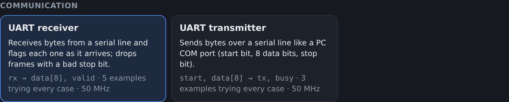
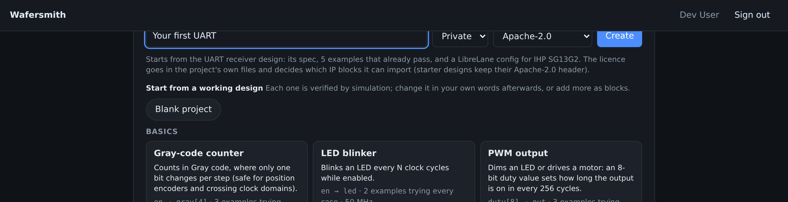
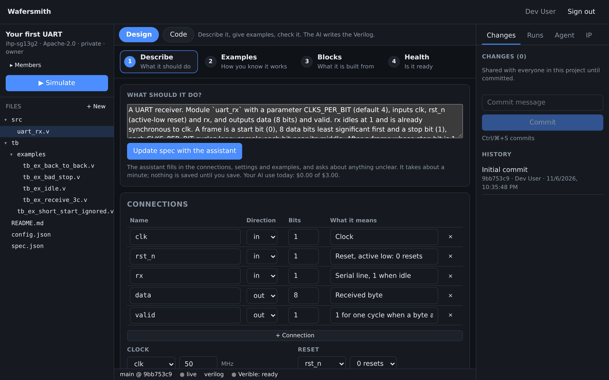
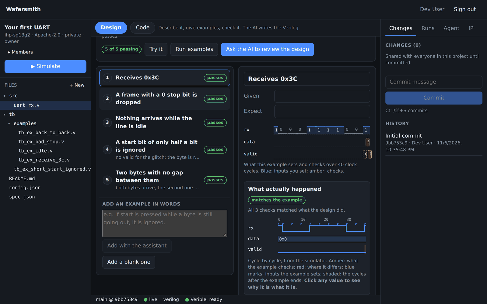
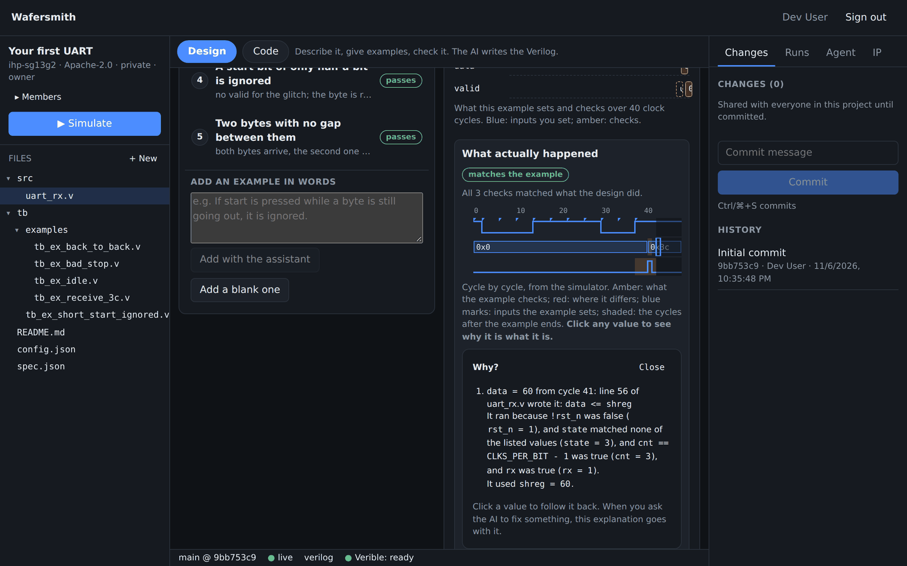
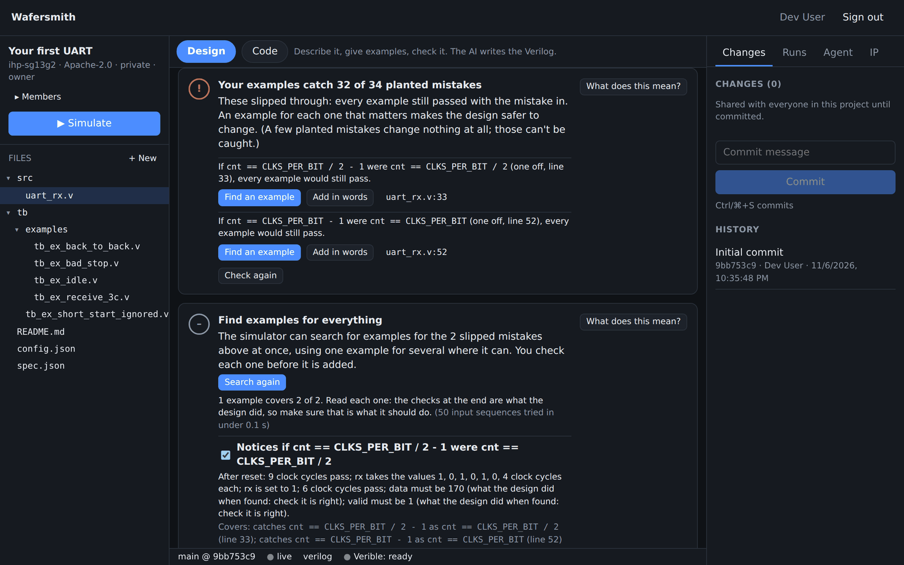
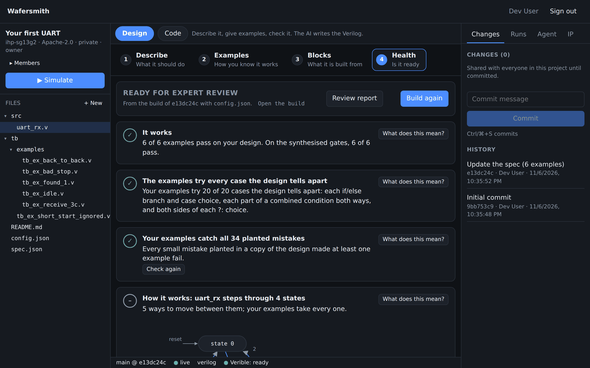
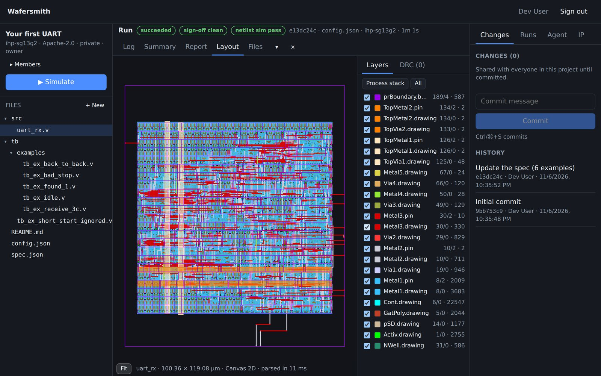

# Your first chip, step by step

This walk-through takes one design from the start page to a checked chip layout in about ten
minutes. You won't write any Verilog, and nothing here uses the AI, so it costs nothing. Once you
know the way round, the other pages of this guide explain each part in depth.

You'll use the **UART receiver** starter: a small block that listens on a serial line (`rx`) and
outputs each byte it receives (`data`), with a one-cycle `valid` pulse when a byte arrives.

**Before you start:** Wafersmith must be running and you need to be signed in. On your own
machine, follow [Getting started](../getting-started.md), open http://localhost:5173 and sign in
with one of the development accounts listed there.

## 1. Start a project

On the start page, under **Start from a working design**, click **UART receiver** in the
Communication group. Every starter is a finished design whose examples already pass.

The name box fills in with the starter's name. Click into it and type your own (each of your
projects needs a different name), leave **Private** and the licence as they are, and click
**Create**.

## 2. Read what it should do

The project opens on the **Design** view, step 1, **Describe**. Here is the design in plain words
("A UART receiver… rx idles at 1… a frame is a start bit, 8 data bits and a stop bit") and its
**connections**: the inputs and outputs, with what each one means.

The files on the left are what Wafersmith keeps for you: the design (`src/uart_rx.v`) and one
testbench per example (`tb/examples/`). You don't need to open them; the **Code** switch at the
top is there for people who want to.

## 3. Run the examples

Click step 2, **Examples**, then **Run examples**. Examples are the tests: each one sets the inputs
over time and says what the outputs must be. The badge should read **5 of 5 passing**.

Click an example in the list to see it on the right:

- The strip at the top shows what the example **sets** (blue, here the bits on `rx`) and what it
  **checks** (amber, here `data` and `valid` at the end).
- **What actually happened** is the design's behaviour, cycle by cycle, from the simulator. Green
  "matches the example" means every check held.

## 4. Ask why

In **What actually happened**, click any value. Here, clicking the byte `0x3c` on `data` explains
where it came from:

It names the line of the design that wrote the value (`data <= shreg`), why that line ran (each
decision around it, with the values it saw), and the values it used. Each of those can be clicked
in turn, so you can follow a value back to the example step that caused it. When an example fails,
this is how you find out why.

## 5. Check its health

Click step 4, **Health**, then **Plant mistakes and check**. Wafersmith makes small mistakes in a
copy of the design, one at a time (a number one off, a comparison turned round), and runs your
examples against each. A mistake that no example notices is a behaviour nothing pins down.

For this design, 2 of 34 slip through. Both change a counter's limit by one. Click **Find
examples for all** in the **Find examples for everything** card: the simulator searches for inputs
that expose them and finds one example that catches both.

Read the example it found. It is written as a sentence ("rx takes the values 1, 0, 1, 0, …; data
must be 170; valid must be 1"), and the checks at the end are **what the design did**, so decide
whether that is what it *should* do. Here it is: the bits form the byte 0xAA, which is 170. If it
weren't, you would have found a bug.

Then:

1. Click **Add 1 example**. It opens in Examples, unsaved.
2. Click **Save spec** at the top. This commits the change to the project's history.
3. Back in **Health**, click **Check again**. All 34 planted mistakes are now caught.

## 6. Build the chip

Still in Health, click **Build and check**. The design goes through the full chip flow (synthesis,
placement, routing and the sign-off checks) for the IHP SG13G2 process. It takes about a minute.

Each card says one thing in plain words:

- **It works**: the examples pass, also on the gates the chip would be made from.
- **The examples try every case**, and **catch all planted mistakes**.
- **Fast enough**, **Can be manufactured** (no layout rule errors, the layout matches the design),
  **Size and power**.

**What does this mean?** on any card explains it and shows the engineering numbers behind it.
**Open the build** shows the run, and its **Layout** tab the chip itself:

"Ready for expert review" is as far as Wafersmith takes you on its own. The last card lists what
an expert still has to check before a real chip is made (pads, manufacturing test, power-up and
the final go/no-go). **Review report** gives them one printable page about the design.

## When an example fails

You'll see this as soon as you change something. A failing example turns red, and **What actually
happened** shows where the design differs. Then:

- **Why wasn't it …?** under the difference lists every line that could have given the expected
  value, and the decision that stopped each one ("`cnt == N - 1` was false (cnt = 2)").
- If the **example** is wrong, **The example: use what the design did** rewrites its check from
  the simulation, after showing you the change.
- If the **design** is wrong, **The design: try a small fix** tries the small repairs that undo the
  most common mistakes, and offers only those after which every example passes, each as a one-line
  change you can accept.
- **The design: ask the AI to fix it** sends the explanation you followed along with the request
  (this uses your AI budget). The AI agent changes a copy of the project; you review its proposal
  and merge it.

## Where to go next

- **Change the design in your own words.** On Describe, edit the text and click **Update spec with
  the assistant**: it updates the connections and examples to match. Then **Ask the AI to make them
  pass** (in Examples), or send a request from the **Agent** panel, and the AI agent changes the
  Verilog until every example passes, for you to review. Both need an API key and count against
  your daily AI budget.
- **Try it** (in Examples) turns the design into a small board you can play with, and turns what
  you did into a new example.
- **Blocks** builds a bigger chip from this design, other starters and imported IP.
- The rest of this guide: [Design view](design-view.md), [Starter designs](starters.md),
  [Blocks](blocks.md), [Code and collaboration](code-and-collaboration.md),
  [Flow runs](flow-runs.md), [AI agent](agent.md), [IP registry](ip-registry.md).
